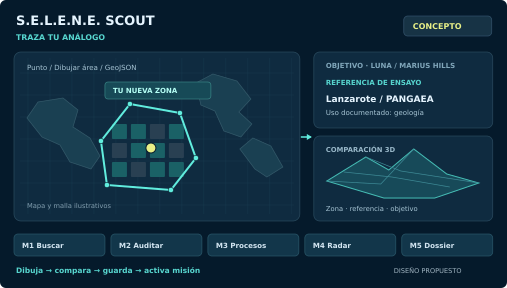

# S.E.L.E.N.E. Ops

## Revisión de propuesta y referentes

**MVP completo · Estado integrado, nuevas zonas y plan de cierre**

**Equipo:** ProdKillers · **Fecha:** 14 de noviembre de 2026 · **Versión:** 4.1

**Base integrada:** `main` en `28cad4d`. **Avance adicional revisado:** rama `feature/module-1-discovery` en `2b64294`, todavía fuera de `main` al preparar este informe.

### Qué ha cambiado

El módulo 2, los recursos NASA, el módulo 3 y el clima visual ya conviven en Mission Control. Existen pronóstico de 72 horas, procesos exploratorios, historia SAR, seguimiento automático de misión, banco 3D y exportaciones. El módulo 1 también tiene un avance concreto en otra rama: búsqueda en dos etapas, refinamiento JAXA multiescala y candidatos generados.

Esta revisión incorpora Scout: crear zonas desde el mapa y conectarlas a todo el flujo, además de integrar descubrimiento, completar riesgos/subsuelo y consolidar el expediente.

### Alcance que se mantiene

**Se conserva la amplitud del MVP:** descubrimiento global y multiescala, zonas personalizadas, ranking y embeddings geoespaciales, auditoría y calibración física, procesos dinámicos, ventanas de 72 horas, SAR/subsuelo, peligros y navegación, visualización Tierra–Luna/Marte, planificación asistida por IA y expediente científico exportable.

Las etapas de integración organizan dependencias. Cada capacidad debe disponer de un caso de aplicación demostrable, resultados reproducibles y evidencia identificada.

### Tres casos de evaluación sugeridos

1. **Lanzarote / Caldera Blanca ↔ Marius Hills:** geología volcánica, muestreo y operaciones lunares vinculadas a cavidades.
2. **Wright Valley ↔ borde de Shackleton:** frío, sequedad, relieve polar, iluminación y contraste térmico.
3. **Atacama / entorno ARADS ↔ Jezero:** muestreo, perforación y preparación ambiental de operaciones marcianas.

Se conservan los cuatro escenarios y el catálogo de 14 sitios. Estos tres casos permiten evaluar capacidades complementarias; la rama de descubrimiento aporta además nuevos micro-sitios para caracterizar.

> S.E.L.E.N.E. descubre, compara y evalúa análogos terrestres para preparar operaciones lunares y marcianas, integrando terreno, ambiente, procesos, subsuelo y decisiones de ensayo con fuentes trazables.

<!-- pagebreak -->

## 1. Estado real de los cinco módulos

Se distinguen tres estados: **integrado en main**, **disponible en rama** y **pendiente de completar**. La presencia de una función no implica validación física experimental.

| Módulo | Avance disponible | Qué falta para finalizar su alcance |
| --- | --- | --- |
| 1 · Descubrimiento | En rama: prefiltro geográfico, refinamiento JAXA a 2.4 y 7.2 km, Top 5 por objetivo, contexto climático y comparación 3D candidato–objetivo. En main: catálogo y cuatro parejas. | Integrar la rama; transferir candidatos a M2–M5; ampliar cobertura y evaluar embeddings, materiales y ranking por operación. |
| 2 · Auditoría | En main: contrato v1.0.0, matriz, calibración, banco 3D, presión superficial, registro de rover/clima y JSON/Markdown/Excel. | Aceptar candidatos descubiertos; enriquecer perfiles de equipo y evidencia; evaluar modelos dinámicos específicos. |
| 3 · Procesos | En main: pronóstico horario de 72 h, ventanas térmicas/eólicas/frías, cruces de 0 °C, laboratorio interactivo y series Sentinel-1. | Calibrar reglas por material/ensayo, contrastar con observaciones y conectar candidatos dinámicos y expediente general. |
| 4 · SAR y subsuelo | En main: DEM, pendientes usadas por el rover, historia SAR terrestre y Mini-RF parcial en Shackleton. | Completar capas de peligros, análisis SAR dedicado, cavidades, obstáculos, iluminación temporal y navegación subterránea. |
| 5 · Mission Control | En main: comparación 3D, escena meteorológica, contexto amplio, siete GLB NASA, dos texturas, copiloto con M2/M3 y reportes M2. | Unificar descubrimiento, capas y planificación; generar expediente de todos los módulos en PDF/Markdown/JSON y completar publicación. |

### Verificación disponible de la integración

**109 pruebas JS, 142 del backend y 30 comprobaciones de navegador aprobadas.** Se verificaron los cuatro escenarios, M2/M3 juntos, clima visual, física, historial SAR, aislamiento de sesiones, Excel de 12 hojas y copiloto integrado.

La revisión cubrió escritorio 1440×1000 y móvil 390×844. El recorrido de integración usó telemetría simulada y pronóstico archivado: no constituye una prueba nueva de Meteomatics ni de un LLM real. Los ensayos históricos de proveedores se conservan por separado.

Fuentes: [contratos](contracts.md), [QA](qa.md) y [resultados de integración](evidencias/integracion-m2-m3/resultados.json). Las pruebas documentadas corresponden al código integrado; no se atribuyen a la rama del módulo 1.

<!-- pagebreak -->

## 2. Tres parejas para evaluar el producto

Las tres parejas ya tienen DEM, contexto visual, pronóstico archivado de 72 h e historia SAR en `main`. El clima actual y el pronóstico por API dependen del proveedor configurado; las ventanas concretas deben recalcularse para la fecha de la demostración.

### A. Caldera Blanca / Lanzarote ↔ Marius Hills

**Centros:** Tierra 29.034°, −13.732°; Luna 14.091°, −56.777°. **Uso:** geología volcánica, muestreo y ensayo de movilidad.

**Ya disponible:** GLO-30, Sentinel-2, radar terrestre VV e historia de **25 escenas**; Kaguya de aproximadamente 33 m y curva regional Diviner de 23 puntos horarios lunares. M2, procesos y escena de clima funcionan sobre la pareja.

**Cómo completar el caso:** añadir materiales y una cavidad con cartografía o geometría publicada. Si queda fuera de Caldera Blanca, registrar otra ventana terrestre con identidad propia. El DEM actual no resuelve el pozo lunar; la curva Diviner describe su entorno regional.

### B. Wright Valley ↔ borde de Shackleton

**Centros:** Tierra −77.517°, 161.833°; Luna −89.78306°, −155.7435°. **Uso:** frío, pendientes, iluminación y preparación de operaciones polares.

**Ya disponible:** GLO-30, Sentinel-2, radar HH e historia de **24 escenas**; LOLA, Diviner PRP y Mini-RF CPR regional de **0.605**. M3 propone ventanas frías cuando el objetivo carece de curva diurna.

**Cómo completar el caso:** incorporar térmica superficial terrestre con cobertura polar, iluminación temporal y evidencia de hielo/estado del suelo. La ventana lunar está en el borde; mínimo y curva Diviner siguen desconocidos. El procesamiento debe respetar polarización y resolución efectiva.

### C. Atacama / entorno ARADS ↔ Jezero

**Centros:** Tierra −24.102°, −70.138°; Marte 18.4447°, 77.4508°. **Uso:** muestreo, perforación, movilidad y evaluación ambiental.

**Ya disponible:** GLO-30, Sentinel-2, radar VV e historia de **26 escenas**; DTM HiRISE de origen cercano a 1 m, remuestreado, y curva de 24 puntos de Mars Climate Database. M3 permite explorar ventanas térmicas y reglas de saltación.

**Cómo completar el caso:** caracterizar materiales/sales y parámetros del ensayo, contrastar procesos con observaciones y complementar MCD con mediciones adecuadas. El marcador ARADS es orientativo; la rejilla común no conserva los obstáculos del DTM original a escala de un metro.

**Wadi Rum–Coprates sigue disponible** para cañón y navegación, con 25 escenas SAR. La selección de tres organiza la evaluación y el pitch.

Fuentes: [escenarios](../assets/data/scenarios.json), [historia de procesos](../assets/data/processes/) y [fuentes planetarias](targets-sources.md).

<!-- pagebreak -->

## 3. Nuevo avance: descubrimiento con JAXA

**Estado: disponible en rama, pendiente de integración.** La revisión se hizo sobre `feature/module-1-discovery` en `2b64294`, mediante lectura de código y JSON. Estos archivos todavía no forman parte de `main`.

### Qué aporta la rama

1. **Prefiltro geográfico:** explora bandas/regiones con elevación GLO-90 y selecciona áreas para refinamiento. Los manifiestos revisados registran 39 evaluaciones gruesas para Marius Hills y 26 para cada uno de los otros objetivos.
2. **Refinamiento multiescala:** usa JAXA ALOS World 3D-30m, colección `alos-dem`, con escalas de 2400 y 7200 m. Registra candidatos, métricas, elevaciones y procedencia.
3. **Panel de descubrimiento:** muestra ranking, coordenadas, regiones, perfiles y terreno candidato–objetivo en 3D. La rama también incorpora amplitud térmica y aridez de ERA5 como contexto.

### Tres ejemplos nuevos que podemos caracterizar

Se muestran los primeros registros de los JSON de los tres objetivos elegidos. Los tres centros están en la región denominada “Southwestern North America” en esos archivos.

| Objetivo y candidato | Centro terrestre [lat, lon] | Índice de selección registrado |
| --- | --- | --- |
| Marius Hills · `cand-marius-hills-01` | [34.0939081, −106.9217292] | 82/100 |
| Shackleton · `cand-shackleton-01` | [34.0289796, −107.1036988] | 97/100 |
| Jezero · `cand-jezero-01` | [34.2020895, −109.0778700] | 83/100 |

Los manifiestos registran **1680, 1680 y 1640 evaluaciones de celda**, respectivamente; Coprates registra 1600. Son evaluaciones del barrido configurado, no prueba de cobertura exhaustiva mundial ni necesariamente celdas únicas entre escalas. Cada archivo conserva cinco candidatos.

### Cómo integrar este avance al MVP amplio

Conectar la selección de descubrimiento con el contrato de M2; cargar meteorología y series por coordenadas; incorporar los resultados a capas, copiloto y expediente. Mantener las parejas conocidas como referencias para contrastar los hallazgos nuevos.

**Acordar antes de integrar:** la rama añade amplitud del aire ERA5 frente a temperatura superficial planetaria al índice. Debe conservarse su papel de proxy, separar magnitudes y permitir explicar sus componentes. Estos índices no son porcentajes de equivalencia ni directamente comparables con el índice geométrico de `main`. La novedad científica requiere revisión documental.

Fuentes: [rama y código revisados](https://github.com/Prodkillers/Atlas/tree/2b64294), [datos generados](https://github.com/Prodkillers/Atlas/tree/2b64294/assets/data/discovery) y [panel](https://github.com/Prodkillers/Atlas/blob/2b64294/discovery.js).

<!-- pagebreak -->

## 4. S.E.L.E.N.E. Scout · Traza tu análogo

**Nueva propuesta de producto, adicional a los tres casos:** crear una zona desde el globo/mapa y convertirla en una misión evaluable por todo el sistema. El usuario también podrá marcar un punto con ventana de análisis o importar un polígono GeoJSON.

*Boceto de interfaz propuesta. Mapa, terreno y estados ilustrativos; no representan una adquisición ni resultados científicos.*

### La experiencia que proponemos

1. **Traza y explora.** Dibujar el área sobre el globo Three.js, con mapa 2D sincronizado como alternativa. El contorno se ilumina, la cámara se acerca y aparece su malla de análisis.
2. **Encuentra su conexión planetaria.** Elegir Luna/Marte y operación, o comparar la zona con los objetivos disponibles. Un mapa de afinidad destaca micro-sitios; una “huella de analogía” separa terreno, materiales, ambiente y procesos según la evidencia.
3. **Contrasta con una referencia factible.** Elegir un sitio con ensayos documentados para la misma operación y comparar zona, referencia y objetivo planetario en vistas sincronizadas.
4. **Ve cómo se construye el análisis.** El recorte 3D se completa por capas a medida que llegan DEM, imágenes, clima y radar. Cada capa muestra su estado y procedencia; el progreso representa trabajo real.
5. **Actívala como misión.** Guardar la zona y abrirla en la vista Tierra–objetivo: auditoría, rover, clima, ventanas de 72 h, SAR, riesgos, copiloto y expediente comparten la misma selección.

**El momento visual central:** el polígono terrestre se transforma en un recorte 3D y se alinea junto al objetivo planetario. La nueva zona queda en “Mis zonas”, comparable con las tres referencias y con los candidatos del buscador.

<!-- pagebreak -->

## 5. Comparar con una referencia factible

**Requisito de Scout:** toda nueva zona trazada debe ofrecer la acción **“Comparar con referencia conocida”**. El usuario podrá elegir un sitio con antecedentes documentados para la operación que quiere ensayar y contrastarlo con su nueva localización y con el objetivo lunar o marciano.

### Selección de la referencia

Filtrar por operación y mostrar qué ensayo se realizó, con qué equipo, en qué sector y con qué fuente. La factibilidad se refiere a ese uso documentado; no se presupone que el sitio sirve para cualquier instrumento u operación.

| Referencia sugerida | Uso documentado que aporta | Qué debe acompañar la selección |
| --- | --- | --- |
| Atacama / ARADS | Perforación robótica y manejo de muestras. | Fuente de campaña, condiciones y sector del ensayo; el marcador actual es orientativo. |
| Caldera Blanca / PANGAEA | Formación humana y recorridos de geología de campo. | Evidencia de entrenamiento y ubicación; distinguirla de una prueba de movilidad robótica. |
| Black Point / Desert RATS | Simulaciones de operaciones y recorridos con vehículos de exploración. | Área de campaña y tipo de ensayo; comprobar la correspondencia con la ventana comparada. |

Fuentes del catálogo: [sitios y antecedentes](../data.js) y [auditoría documental](source-audit.md).

### Comparación visual de tres escenarios

Proponer una vista **Zona trazada | Referencia conocida | Objetivo planetario**, con cámaras sincronizadas y selector de capas; en móvil, usar pestañas o un comparador deslizante. Superponer perfiles de terreno y mostrar una matriz por variable: valores, diferencias, unidades, fechas, cobertura y fuentes.

Comparar a escala y resolución efectivas compatibles, con el mismo perfil de ensayo. Si una referencia solo tiene el DEM 9×9 del catálogo, preparar datos adecuados antes de emitir diferencias cuantitativas. Las variables incompatibles o faltantes quedan identificadas.

### Resultado y trazabilidad

La comparativa explica qué condiciones del ensayo de referencia reproduce la nueva zona, dónde difiere y qué pruebas adicionales necesita. Mantener separados semejanza geométrica, evidencia de ensayo y condiciones operativas; una puntuación global no convierte automáticamente el nuevo sitio en factible.

Guardar `referenceSiteId`, revisión, perfil de operación, parámetros y evidencias junto a la revisión de la zona. M2 audita cada sitio frente al mismo objetivo; M3 compara sus ventanas; M4 contrasta peligros; el copiloto y el expediente incorporan la comparativa completa.

**Aceptación:** la zona nueva puede compararse con al menos una referencia pertinente y documentada; cambiar referencia actualiza vistas y reporte, preserva la identidad de cada sitio y declara las diferencias y los datos no comparables.

<!-- pagebreak -->

## 6. Cómo hacer Scout compatible con todo

### Un registro común de zonas y escenarios

Crear un registro que resuelva tanto las cuatro parejas actuales como los candidatos de M1 y las zonas del usuario. Cada zona conserva polígono, centro, escala, fuente de selección y revisión. Su identidad viaja por todos los módulos.

El polígono GeoJSON usa **[longitud, latitud]**; el adaptador entrega el centro **[latitud, longitud]** del contrato actual. Áreas grandes se analizan por lotes multiescala y producen ventanas comparables con el objetivo; la forma dibujada no se fuerza artificialmente a una sola rejilla.

| Destino | Conexión propuesta | Comportamiento esperado |
| --- | --- | --- |
| M1 · Buscar | Ejecutar el refinamiento dentro del polígono y conservar cobertura, escala y descartes. | Clasificar micro-sitios propios y compararlos con los objetivos disponibles. |
| M2 · Auditar | Resolver el DEM y construir el `CandidateAnalogPayload` existente. | Igualar `earthId`, ID de rejilla y `telemetry.site`; conservar unidades y procedencia. |
| M3 · Procesos | Consultar clima/pronóstico por coordenadas y preparar series de la zona. | Ventanas de 72 h e historial propios, con emisión, validez y antigüedad visibles. |
| M4 · Capas | Ejecutar los trabajos SAR, terreno, cavidades y peligros sobre la geometría elegida. | Mostrar capas adquiridas, inferidas o simuladas con su cobertura; sin reutilizar resultados de otra zona. |
| M5 · Misión | Añadir escenario al selector y compartir la selección con visor, rover, copiloto y reportes. | Activar la zona sin editar manualmente `scenarios.json`; conservar revisiones y sesiones separadas. |

### Identidad, versiones y actualización

**Ejemplo propuesto:** `earthId=zone-<hash>` y escenario derivado de zona + objetivo. El ID debe respetar los identificadores que acepta la API. Mantener `CandidateAnalogPayload` v1.0.0 mediante un adaptador; guardar el polígono y la revisión en el registro externo, con referencias a los artefactos analíticos.

Guardar resultados reproducibles por revisión y ofrecer **“Actualizar datos”** para crear otra. El clima puede refrescarse con su cadencia; DEM, radar e imágenes conservan sus fechas. Cambiar de zona cancela solicitudes pendientes y evita que una respuesta anterior contamine la misión activa.

Para una zona sin proveedor o archivo propio, declarar la ausencia. Un pronóstico archivado de un sitio cercano no se presenta como si perteneciera a la zona dibujada. Los presets visuales siguen separados de los datos del análisis.

<!-- pagebreak -->

## 7. Implementación y demostración de Scout

**Diseño propuesto; las rutas siguientes todavía no existen.** Reutilizar Three.js, FastAPI, los pipelines Python y los motores actuales, con procesamiento asíncrono para las adquisiciones costosas.

### Secuencia de construcción

1. **Selector geográfico.** Añadir dibujo de punto/polígono, edición, deshacer e importación GeoJSON. Validar geometría y coordenadas, calcular extensión y presentar escala/cobertura antes de ejecutar.
2. **Registro y trabajos.** Proponer `POST /api/zones` para guardar la zona y `POST /api/zones/{id}/analyses` para iniciar su análisis con objetivo, operación y escala. Devolver un `jobId`; procesar DEM, métricas, clima y SAR en workers con caché por geometría, producto, resolución y período.
3. **Resultados progresivos.** Publicar eventos mediante `GET /api/jobs/{jobId}/events` y un manifiesto de capas por zona/revisión. El visor muestra vista previa, capas disponibles y estados pendientes, sin inventar un porcentaje de completitud.
4. **Adaptación al sistema vivo.** Refactorizar los resolutores de terreno e historia de procesos: hoy usan rutas estáticas por ID. Hacer que acepten archivos actuales y artefactos dinámicos; conservar la misma interfaz para M2, procesos y contexto del copiloto.
5. **Activación y persistencia.** Guardar zona, revisión, referencia de ensayo, fuentes y resultados. El botón “Activar misión” abre una sesión propia y actualiza toda la consola. Un enlace con zona/revisión permite reabrir el análisis, y “Actualizar datos” genera una revisión nueva.

### Qué aparece inmediatamente y qué requiere trabajo

El contorno, los controles y la geometría preliminar pueden mostrarse al seleccionar. La topografía analítica, el ranking, las ventanas y la historia SAR aparecen después de consultar/procesar sus fuentes. Una capa ausente conserva su estado; cada módulo debe demostrar su función con datos aplicables.

### Demo de impacto

Dibujar una zona fuera de las referencias → elegir un objetivo lunar → ver la construcción del recorte 3D y sus capas → comparar micro-sitios y una referencia factible → activar misión → consultar clima/72 h y auditoría → simular el rover → exportar expediente → reabrir el enlace guardado.

**Aceptación:** la zona recorre los cinco módulos; los reportes conservan geometría, revisión, referencia documentada y fuentes; un cambio rápido de zona no mezcla resultados; la falta de cobertura queda visible; las tres referencias siguen funcionando. Verificar también actualización, cancelación y reapertura sin depender de una sesión previa del navegador.

<!-- pagebreak -->

## 8. Cómo completar los motores científicos

La funcionalidad existente sirve de base. Las siguientes entregas completan el alcance de cada módulo y conectan las piezas que ya funcionan.

| Frente | Trabajo de finalización | Resultado demostrable |
| --- | --- | --- |
| M1 · Descubrimiento | Integrar búsqueda en dos etapas; adaptar candidatos; versionar componentes; incorporar materiales y evaluar recuperación con embeddings. | Una consulta devuelve Top 5 explicables y permite abrir un candidato en toda la consola. |
| M2 · Auditoría | Conectar candidatos dinámicos; completar perfiles de rover, rueda y taladro; asociar modelos de ensayo a parámetros y fuentes. | Cambiar sitio/equipo actualiza cálculo, visualización, historial y reporte de forma coherente. |
| M3 · Procesos | Parametrizar reglas por material y ensayo; tratar cobertura temporal/huecos; contrastar modelos con observaciones independientes. | Pronóstico y laboratorio producen ventanas explicadas con criterios, incertidumbre y origen de las variables. |
| M4 · SAR/subsuelo | Preparar análisis dedicado de cambios, integrar cavidades publicadas, evaluar detectores, capas de peligros y navegación. | Capas georreferenciadas y rutas; distinción visible entre evidencia registrada, inferencia y simulación. |
| M5 · Síntesis | Componer un resultado común de M1–M4 y conectar las herramientas de IA al mismo corte de datos. | Plan de ensayo y expediente integral consistentes con los valores del visor. |

### Modelos que deben conservar su significado

M3 compara forma y fase normalizadas del ciclo térmico. La fase de un día lunar no representa la misma duración física que una hora terrestre. Las reglas de saltación y los cruces de 0 °C son modelos exploratorios; por sí solos no demuestran una tormenta observada o hielo en el suelo.

Actualmente `processes.mjs` puede usar temperatura del aire cuando falta la superficial. Completar la trazabilidad de ese respaldo por variable y evitar presentarlo como una medición superficial. La humedad del aire tampoco sustituye una medición de humedad del material.

La serie SAR es evidencia de retrodispersión y cambios. Una anomalía no confirma una cavidad profunda o un techo transitable; completar esa función exige geometría, cartografía o sondeo independiente adecuado. Las escenas subterráneas simuladas deben conservar esa identificación.

### Datos para completar las funciones

Completar materiales, cavidades publicadas, imágenes/DEM de detalle e iluminación temporal. Integrar productos RADARSAT/RCM identificados y datos terrestres NASA: ECOSTRESS donde haya cobertura y un producto polar apropiado para Wright Valley.

Fuentes de implementación: [procesos](../processes.mjs), [telemetría](../server/telemetry.py), [contratos](contracts.md) y [producto ECOSTRESS](https://doi.org/10.5067/ECOSTRESS/ECO_L2T_LSTE.003).

<!-- pagebreak -->

## 9. Completar Mission Control, IA y experiencia

### Lo que ya aporta la escena integrada

Mission Control tiene cámara sincronizada Tierra–objetivo, clima actual o simulado, posición solar, efectos de ambiente y terreno de contexto más amplio. El contexto es de menor resolución que la ventana analítica de 2.4 km y debe seguir identificado por separado.

El banco M2 conecta carga original, descarga vertical y masa equivalente con el equipo de misión. La colección incluye siete GLB NASA y dos texturas cartográficas; los recursos se cargan bajo demanda y conservan atribución. Sus mallas tienen un papel visual, no suministran propiedades científicas.

### Plan visual ya documentado

| Entrega | Cómo completarla conservando funciones |
| --- | --- |
| Iluminación y material | Ajustar tono/color, luz por cuerpo y hora, sombra del rover y detalle visual de terreno. Evaluar rendimiento con vista dividida. |
| Interfaz centrada en simulación | Mantener accesibles comparación, procesos, M2, Flight Director, fuentes y detalles técnicos mediante paneles/cajones. Conservar el catálogo y la búsqueda. |
| Idiomas | Centralizar textos y ofrecer EN/ES, incluyendo respuestas por reglas y mensajes de procesos; verificar unidades y formatos. |
| Calidad de imagen | Incorporar texturas de mayor detalle y carga progresiva. Separar malla de dibujo de la rejilla usada para métricas. |
| Climas por sitio | Filtrar presets por plausibilidad y marcar escenarios excepcionales; diferenciar clima modelado actual y simulación seleccionada. |

Son tareas del [plan visual](plan-visual-refactor.md); no se presentan como mejoras ya ejecutadas. Las pruebas de rendimiento y accesibilidad deben acompañar su implementación.

### Agentes y expediente completo

El copiloto ya recibe contexto de M2 y M3. Para completar el planificador, conectar herramientas de descubrimiento, auditoría, procesos y radar; componer el ensayo y verificar cifras/citas antes de exportar. Los agentes usan cálculos deterministas y evidencia versionada.

Consolidar **PDF, Markdown y JSON del expediente de todos los módulos**. El Excel de 12 hojas y los dossiers actuales de M2 se mantienen como base; todavía no incluyen automáticamente la síntesis completa del descubrimiento y de todos los procesos/capas.

El PDF de este informe es documentación de proyecto. Su generación no significa que el exportador PDF del producto ya esté implementado.

Fuentes: [módulo 2](modulo-2.md), [recursos NASA](nasa-assets.md), [contratos](contracts.md) y [README](../README.md).

<!-- pagebreak -->

## 10. Secuencia de cierre y evaluación completa

La secuencia aprovecha el código integrado y el avance de descubrimiento. Mantiene el alcance funcional completo y hace verificables sus dependencias.

| Etapa | Trabajo | Criterio de salida |
| --- | --- | --- |
| A · Integrar M1/Scout | Conciliar contratos y resolver candidatos del buscador o zonas dibujadas mediante el registro común. | Un micro-sitio o zona personalizada abre M2/M3 conservando identidad, escala y origen. |
| B · Completar evidencia | Adquirir clima/series del candidato, materiales, datos NASA y productos de detalle/SAR/subsuelo. | Cada capa contiene producto, cobertura, fechas, unidades y método ejecutado. |
| C · Cerrar capacidades | Completar M4, perfiles de ensayo, evaluación de procesos, embeddings y planificación asistida. | Cada capacidad del alcance tiene un caso aplicable demostrado y un tratamiento explícito de ausencias. |
| D · Unificar experiencia | Ejecutar plan visual, composición de resultados y exportadores integrales. | Paneles, copiloto y expediente comparten el mismo corte de datos. |
| E · Evaluar y publicar | Ejecutar QA integrado, validar artefactos, desplegar y preparar video/pitch/ficha. | URL funcional y evidencias del recorrido completo, con versión y fuentes. |

### Matriz de evaluación sugerida

**Lanzarote–Marius Hills:** probar auditoría lunar, geología/muestreo, ruptura térmica, materiales y recorrido de cavidad cuando exista la geometría adecuada.

**Wright Valley–Shackleton:** probar datos polares, pendientes, iluminación, ventana fría y manejo correcto de mínimos/curvas ausentes.

**Atacama–Jezero:** probar muestreo/perforación, ventana térmica, reglas de transporte de arena, balance de energía y planificación de ruta.

**Candidatos del módulo 1:** repetir el flujo con un micro-sitio generado. La evaluación debe comprobar la transferencia de coordenadas, DEM, clima, fuentes e historial, sin heredar datos de la pareja de referencia.

### Demostración del producto terminado

Elegir objetivo → ejecutar búsqueda o dibujar una zona → comparar candidatos y referencia factible → abrir uno en 3D → revisar auditoría y equipo → consultar procesos y ventana de 72 h → activar SAR/subsuelo/peligros → simular navegación → generar el plan con IA → exportar expediente.

Evaluar cambio de escenario, actualización temporal, proveedor ausente y datos incompletos; comprobar que las exportaciones conservan cifras y fuentes. Las etapas expresan dependencias; su duración depende de accesos, procesamiento y tareas asignadas al equipo.

<!-- pagebreak -->

## 11. Aprendizajes de los nueve referentes

Se conserva la revisión previa de sus fichas y repositorios seleccionados. La última columna propone cómo aplicar esos patrones al producto actual; no atribuye a los referentes una validación científica independiente.

| Referente | Aporte aprovechable | Aplicación a S.E.L.E.N.E. |
| --- | --- | --- |
| [PureFlow](https://www.spaceappschallenge.org/2025/find-a-team/pureflow2/?tab=project) | Configuración guiada, visualización y consecuencias de ingeniería. | Extender la conexión ya existente entre equipo, banco M2 y cálculos al plan de ensayo completo. [Demo](https://larasdiniz.github.io/PureFlow-2025/src/public/html/home/home.html). |
| [Twisters / SkySense](https://www.spaceappschallenge.org/2025/find-a-team/twisters/?tab=project) | Ventanas meteorológicas para actividades concretas. | Refinar el M3 implementado para instrumentos/operaciones, con criterios, alertas y explicación por el copiloto. |
| [TengriSpacers](https://www.spaceappschallenge.org/2025/find-a-team/tengrispacers/?tab=project) | Pipeline SAR, análisis temporal y exportación. | Aprovechar la historia de 12 meses e integrar análisis dedicado, evidencias y capas del módulo 4. |
| [GRIT-X Awa](https://www.spaceappschallenge.org/2025/find-a-team/grit-x-awa/?tab=project) | Validación de entradas, métricas y experiencia para públicos distintos. | Validar candidatos importados y ofrecer conclusión breve junto al detalle científico y la evaluación de modelos. |
| [Photonics Odyssey / AakashNet](https://www.spaceappschallenge.org/2025/find-a-team/photonic-force/?tab=project) | Problema territorial concreto y arquitectura modular. | Explicar a quién sirve la búsqueda global, qué operación prepara y cómo se amplía la cobertura. |
| [CloudMap / AirWatch Pro](https://www.spaceappschallenge.org/2025/find-a-team/cloudmap/?tab=project) | Fuentes múltiples, gráficos, alertas y exportación. | Mostrar estado, antigüedad y cobertura por capa; distinguir integraciones activas de las pendientes. |
| [TechNova / Meteor Madness](https://www.spaceappschallenge.org/2025/find-a-team/technova3/?tab=project) | Aprender, simular y decidir con parámetros visibles. | Unificar “Explorar → Comparar → Preparar ensayo” conservando acceso a supuestos y resultados. |
| [Titan / Pale Blue Dot](https://www.spaceappschallenge.org/2025/find-a-team/titan46/?tab=project) | Narrativa desde el espacio hasta procesos terrestres. | Conectar briefing y exploración 3D con objetivo, candidato, procesos y evidencia. |
| [Zumorroda-X](https://www.spaceappschallenge.org/2025/find-a-team/zumorroda-x/?tab=project) | Casos locales, imágenes comparadas y decisiones interactivas. | Crear misiones educativas que comparen candidatos y hagan comprensibles las rupturas de analogía. |

**Código y atribución:** [GRIT-X-Awa declara MIT](https://github.com/GRITX-AWA/GRIT-X-Awa/blob/main/LICENSE). En las raíces revisadas de [PureFlow](https://github.com/larasdiniz/PureFlow-2025) y [GlacierSAR](https://github.com/Apelsinovich/GlacierSAR-Kyrgyzstan) no se encontró `LICENSE`; aclarar permisos antes de incorporar código. El conversor PNG revisado de GlacierSAR ajusta contraste: el análisis cuantitativo debe conservar los valores científicos y su procesamiento.

<!-- pagebreak -->

## 12. Fuentes, estado y acuerdos del equipo

### Base técnica de esta revisión

| Fuente | Qué respalda |
| --- | --- |
| [Main integrado · 28cad4d](https://github.com/Prodkillers/Atlas/tree/28cad4d) | Estado conjunto de M2/NASA, M3, clima visual y terreno de contexto. |
| [README](../README.md), [contratos](contracts.md) y [módulo 2](modulo-2.md) | Funciones de la consola, formatos, sesiones, configuración de equipo y exportaciones. |
| [QA](qa.md) y [resultados de integración](evidencias/integracion-m2-m3/resultados.json) | 109 pruebas JS, 142 del backend y 30 comprobaciones de navegador previamente ejecutadas. |
| [Escenarios](../assets/data/scenarios.json), [fuentes planetarias](targets-sources.md) e [historia SAR](../assets/data/processes/) | Parejas, coordenadas, naturaleza de los productos y series de los casos propuestos. |
| [Módulo 1 · 2b64294](https://github.com/Prodkillers/Atlas/tree/2b64294), [datos](https://github.com/Prodkillers/Atlas/tree/2b64294/assets/data/discovery) y [contratos de rama](https://github.com/Prodkillers/Atlas/blob/2b64294/docs/contracts.md) | Implementación de descubrimiento y candidatos disponibles fuera de main. |
| [Plan visual](plan-visual-refactor.md) | Tareas documentadas de iluminación, terreno, idiomas, calidad de imagen y presets por sitio. |
| [Arquitectura](../../docs/arquitectura_y_entregables_s_e_l_e_n_e_ops.md), [challenge](challenge.md) y [recomendaciones](recomendaciones-modulos.md) | Visión amplia y antecedentes. Algunas descripciones de estado son anteriores a la integración y deben leerse con ese contexto. |

### Acuerdos para la reunión

1. **Conservar todo el alcance** y usar la secuencia de cierre para coordinar entregas verificables.
2. **Mantener los tres casos sugeridos** y añadir la evaluación de micro-sitios generados por M1. El cuarto escenario y los 14 sitios siguen disponibles.
3. **Integrar M1 y Scout mediante un registro común** y acordar cómo se muestran geometría, térmica y contexto climático antes de combinar índices.
4. **Asignar la finalización de M4 y del expediente integral**, aprovechando las series SAR, la escena y los reportes ya implementados.
5. **Medir el cierre con evidencia:** funciones aplicables demostradas, pruebas integradas, fuentes por resultado y recorrido completo en la aplicación publicada.

### Alcance documental

Este informe actualiza el estado y propone Scout; no integra la rama M1 ni implementa las funciones nuevas. La evidencia de pruebas corresponde a la integración previa de main. En esta actualización se revisaron documentos, código y datos, y se comprobaron los artefactos generados; no se repitieron las suites de software ni las consultas de proveedores externos.

El ranking propone candidatos por caracterizar. Documentar novedad, condiciones de acceso y validación de campo forma parte de la evaluación completa del MVP.
